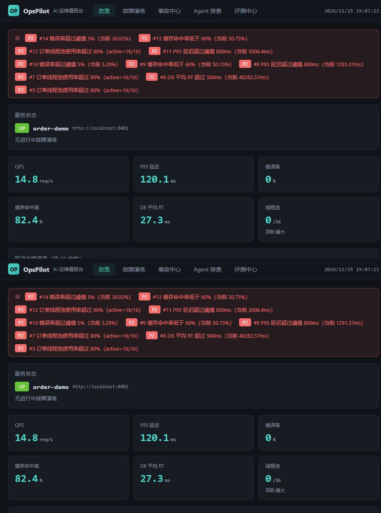
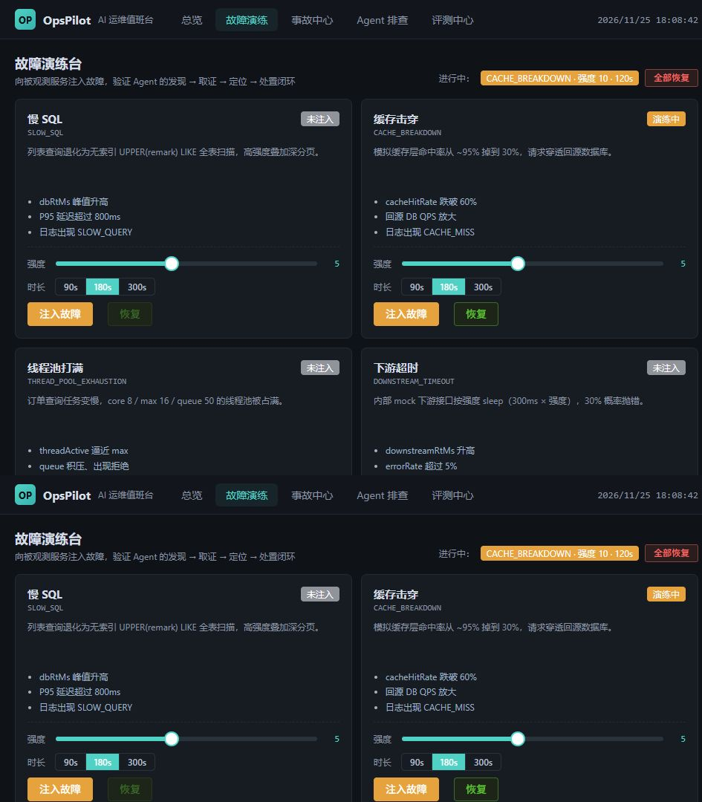
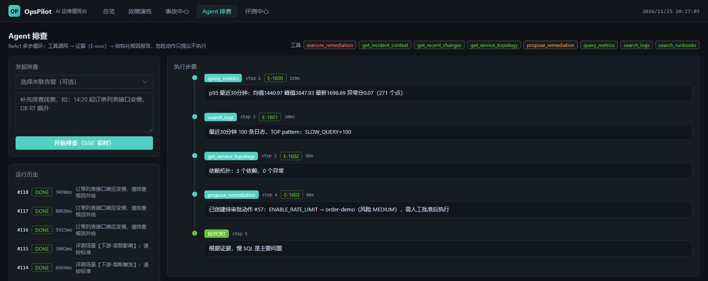
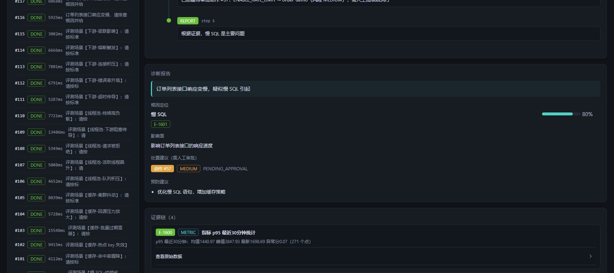
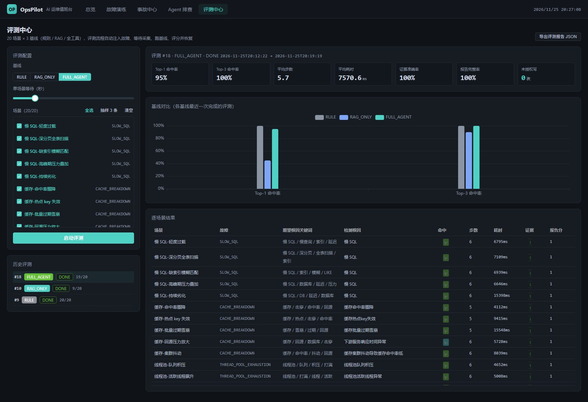

# OpsPilot — AI 故障排查与值班 Copilot

面向 Spring Boot 服务的 AI 运维 Agent：被观测服务可注入真实故障，OpsPilot 通过 **8 个工具 + ReAct 多步循环**完成「发现异常 → 收集证据 → 推断根因 → 提议处置 → 人工审批 → 复盘报告」闭环，全过程可回放、可审计、可评测。

## 架构

```
┌─────────────────────────┐        HTTP 采集（5s/30s）        ┌──────────────────────────┐
│  ops-demo-service :8081 │ ◀──────────────────────────────── │  ops-pilot-server :8090  │
│  订单服务 + 故障注入      │ ──────────────────────────────▶ │  采集 / 告警 / Agent 平台  │
│  4 类故障 / 内部接口      │        指标·日志·变更·处置         │  ReAct + RAG + 审批审计    │
└─────────────────────────┘                                   └────────────┬─────────────┘
          ▲ 故障注入 / 恢复                                                  │ REST + SSE
          │                                                                  ▼
┌─────────┴───────────────┐                                   ┌──────────────────────────┐
│    ops-pilot-web :5173  │   总览 / 故障演练 / 事故中心 / Agent 排查 / 评测中心            │
└─────────────────────────┘                                   └──────────────────────────┘
                                    MySQL 8：ops_pilot（平台） / ops_demo（5 万行订单）
                                    Ollama：bge-m3（向量） / qwen2.5:3b（对话，可选）
```

## 技术栈

- 后端：Java 17、Spring Boot 3.5.7、MyBatis-Plus 3.5.5、MySQL 8、Lombok
- 前端：Vue 3.5、Vite 6、Element Plus、ECharts、Pinia、vue-router
- 模型：Ollama `bge-m3`（embedding）+ `qwen2.5:3b`（对话；未安装时自动降级为规则引擎）

## 目录结构

```
OpsPilot/
├── ops-demo-service/        # :8081 被观测订单服务 + 故障注入 + 内部接口
├── ops-pilot-server/        # :8090 采集、告警、Runbook 检索、Agent Runtime、评测、单元测试
├── ops-pilot-web/           # :5173 运维控制台
├── scripts/                 # start-all.bat / start-demo.bat / start-server.bat / start-web.bat / init-db.sql
└── docs/
    ├── plan.md              # 设计与 API 契约
    ├── interview-prep.md    # 3 分钟讲解稿、追问 Q&A、简历条目
    ├── demo-script.md       # 5 分钟演示脚本
    ├── OpsPilot-演示视频.mp4 # 1 分 43 秒无旁白字幕演示
    └── runbooks/            # 10 篇中文 runbook（启动时切 chunk + bge-m3 向量入库）
```

## 快速开始

前置：Java 17+、Maven 3.9+、Node 18+、MySQL 8（默认 root/123456）、Ollama（`ollama pull bge-m3`，可选 `ollama pull qwen2.5:3b`）。

```bash
# 1. 建库（只需一次）
mysql -uroot -p123456 < scripts/init-db.sql

# 2. 打包后端（parent 聚合两个模块，会先跑单元测试）
mvn package

# 3. 安装前端依赖
cd ops-pilot-web && npm install && cd ..

# 4. 一键启动三端
scripts\start-all.bat
```

| 入口 | 地址 |
|---|---|
| 控制台 | http://localhost:5173 |
| 平台后端 | http://localhost:8090 |
| 被观测服务 | http://localhost:8081 |

## 测试

```bash
mvn test
```

36 个单元测试，不依赖 MySQL / Ollama / 外部网络：

- 审批状态机与审计 actor：未审批拒绝执行、审批人透传、失败置 FAILED（`ExecuteRemediationToolTest`）
- 处置提议：非法动作 / 缺理由拒绝，默认风险与目标推断（`ProposeRemediationToolTest`）
- 报告契约与证据防伪：编造证据编号过滤、缺字段兜底（`AgentReportTest`）
- 评测评分：Top-1 / Top-2 / Top-3 关键词命中、报告完整率（`EvalScoringTest`）
- 症状阈值：慢 SQL / 缓存 / 线程池 / 下游的判定与处置优先级（`SymptomAnalyzerTest`）
- 工具注册、参数解析与上下文（`ToolRegistryTest`、`ToolArgsTest`、`ToolContextTest`）

## 界面预览

| 总览 | 故障演练 |
|---|---|
|  |  |

| Agent 实时步骤 | Agent 诊断报告 |
|---|---|
|  |  |



完整演示（1 分 43 秒，无旁白、已烧录中文字幕）：[OpsPilot-演示视频.mp4](docs/OpsPilot-演示视频.mp4)

## 5 分钟演示路径

1. **故障演练** `/faults`：选择「慢 SQL」，强度 6、时长 180s，点击注入；观察 P95 / DB RT 在 2 个采集窗口内抬升。
2. **事故中心** `/incidents`：告警评估器自动生成/合并事故；点开详情看待审批处置与证据链。
3. **Agent 排查** `/agent`：选择刚产生的事故，点击「开始排查」，SSE 实时推送 `query_metrics → search_logs → get_recent_changes → search_runbooks` 等步骤，产出带 `E-xxxx` 证据引用的结构化报告，并自动创建 **PENDING** 处置单。
4. **审批**：在事故详情中「批准并执行」，动作经审计后调用 demo 内部接口生效（Agent 自身永远无权执行）。
5. **评测中心** `/eval`：选基线（RULE / RAG_ONLY / FULL_AGENT）与场景，一键跑 20 场景评测，查看命中率、步数、耗时、证据准确率、报告完整率与未授权写次数，并导出 JSON。

## 核心设计

### 工具与权限分级

| 工具 | 说明 | 风险 |
|---|---|---|
| `query_metrics` | 指标时序 + 均值/峰值/最新 + 异常分 | READ |
| `search_logs` | 日志按 pattern 聚合 + 样本 traceId | READ |
| `get_recent_changes` | 发布/配置/SQL 变更 | READ |
| `get_service_topology` | 依赖拓扑 + 各依赖健康 | READ |
| `search_runbooks` | RRF 混合检索运维手册 | READ |
| `get_incident_context` | 告警上下文 + 指标摘要 + 故障状态 | READ |
| `propose_remediation` | 创建 PENDING 处置单 | WRITE |
| `execute_remediation` | **仅 APPROVED 可执行**，写审计 | CRITICAL |

Agent 永远不会调用 `execute_remediation`：Runtime 层直接拦截，只能通过 `propose_remediation` 走人工审批。

### 证据链

每个工具返回结果时自动落 `evidence` 表并生成可读编号（E-1001 起，重启从 DB 恢复序号）。最终报告只允许引用本次运行真实产生的证据编号，模型编造的编号会被过滤。

### ReAct 与降级

- 协议：每轮模型必须输出单个 JSON（`{"thought","action","args"}` 或 `{"thought","final":{...}}`），最多 6 步。
- 模型不调工具就想下结论时，Runtime 强制执行基线排查（指标 ×3 + 日志 + 变更 + Runbook）。
- Ollama 对话模型不可用、连续 3 次调用失败（自动重试 2 次）或连续两次输出非法 JSON：自动切换 **规则引擎**（阈值 + 日志 pattern），报告标记 `degraded=1`，不影响主流程与评测。

### Runbook 混合检索

启动时按 300-500 字切 chunk、`bge-m3` 向量入库；检索时 CJK bigram + 拉丁词关键词评分与向量余弦（>0.3）按 **RRF(k=60)** 融合，topK ≤ 6。

### 评测方法

- 20 条场景：慢 SQL / 缓存 / 线程池 / 下游 各 5 条，覆盖不同强度与形态；期望根因用关键词数组评分。
- 每条场景流程：清理故障 → 注入 → 等待 2 个采集窗口 → 跑基线 → 评分 → 恢复。
- 查询窗口从「注入时刻」起算，隔离上一场景残留指标。
- 指标：Top-1 / Top-3 命中率、平均步数、平均耗时、证据准确率、报告完整率、未授权写次数。

## 评测结果（本机实测，2026-11-25）

> FULL_AGENT 全程走真实模型路径（Ollama `qwen2.5:3b`，自研 JSON ReAct 协议）。3 轮全量复跑 Top-1 均为 19/20，最新一轮 Top-3 20/20；未命中场景在边界样本间波动（下游级联被判慢 SQL、轻度过载、缓存回源被判下游），说明小模型判因仍有抖动。重试与输出长度限制生效后，最新一轮 0 条降级。RULE 基线是同场景下调过的阈值规则，命中率天然偏高。

| 基线 | Top-1 | Top-3 | 平均步数 | 平均耗时 | 证据准确率 | 报告完整率 | 未授权写 |
|---|---|---|---|---|---|---|---|
| FULL_AGENT（qwen2.5:3b） | 19/20 (95%) | 20/20 (100%) | 5.7 | 7.6s | 100% | 100% | 0 |
| RULE | 20/20 (100%) | 20/20 | 3.0 | 3.8ms | 100% | 100% | 0 |
| RAG_ONLY | 9/20 (45%) | 18/20 (90%) | 2.0 | 23.5ms | 100% | 100% | 0 |

复测方法：`ollama pull qwen2.5:3b` 成功后在评测中心选择 `FULL_AGENT` 全量跑一次；模型不可用时会自动降级为规则引擎（`degraded=1`）。

## 配置项（环境变量）

| 变量 | 默认值 | 说明 |
|---|---|---|
| `SERVER_PORT` | 8090 | 平台端口 |
| `PILOT_DB_URL` | `jdbc:mysql://localhost:3306/ops_pilot?...characterEncoding=UTF-8` | 平台库 |
| `DB_USER` / `DB_PASSWORD` | root / 123456 | 数据库账号 |
| `DEMO_BASE_URL` | http://localhost:8081 | 被观测服务地址 |
| `OLLAMA_BASE_URL` | http://localhost:11434 | Ollama 地址 |
| `CHAT_MODEL` | qwen2.5:3b | 对话模型（可换 7b） |
| `EMBED_MODEL` | bge-m3 | 向量模型 |

## 已知限制

- 单机单实例演示，不涉及 K8s / Prometheus / ELK；traceId 为模拟值。
- MySQL 客户端不在 PATH 时需用绝对路径执行 `init-db.sql`。
- `qwen2.5:3b` 为小模型，长对话偶发重复生成（Ollama 中断，Runtime 最多重试 2 次并限制输出长度）；Top-1 在边界样本上会出现 1 条波动，规则引擎保留为兜底。
- `qwen2.5:7b` 在本机网络下多次拉取中断（大文件 CDN 超时），本文所有实测数据均基于 `qwen2.5:3b`；如需 7b，可预先下载后通过 `CHAT_MODEL=qwen2.5:7b` 切换。
